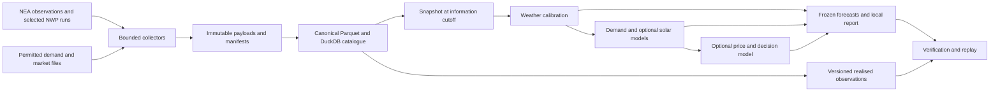

# Singapore power weather project: scope and implementation plan

Date: 6 November 2026. Status: proposed implementation plan. No forecasting features, scheduled collectors, subscriptions or trades were implemented by this research task. See the [research assessment](./singapore-power-weather-research.md) for the forecasting rationale and primary sources.

## 1. Product and release boundaries

**Product:** a reproducible Singapore weather-to-power research workbench that publishes a dated next-day outlook, explains forecast revisions, and measures whether weather improves power forecasts and feasible decisions.

Initial assumptions: one researcher; the inspected laptop; public data; no confirmed additional hardware, market subscription, asset or trading mandate. Treat commercial API eligibility as a separate source-access decision. The architecture supports licensed data later.

| Release | Included | Exit condition |
|---|---|---|
| R0: data and resource feasibility | Repair/validate the existing execution path; audit sample schemas and rights; one bounded weather source; measure download, RAM and storage costs | A reproducible small run with correct times/units and a feasible archive budget |
| R1: weather research | Singapore station verification, compact NWP forecasts, raw/bias-corrected baselines, empirical uncertainty, frozen next-day forecasts and scorecards | Timely reproducible forecasts; measured skill and limitations; 14-day operational shakeout |
| R2: demand and conditional solar | Half-hourly demand forecasts using forecast weather; optional irradiance/PV evaluation when measured truth is available | Incremental value over a strong calendar/raw-weather baseline on chronological holdouts |
| R3: economic research | Permitted prices and market context; forecast-vintage comparisons; one feasible paper procurement/flexibility experiment | Forward evidence of value after realistic costs and documented settlement basis |

R1 can succeed without price data. R2 demand research can proceed without a solar model. R3 is conditional on data access and an explicitly defined economic decision. A negative skill result is a useful research outcome and should stop unnecessary model expansion.

Out of initial scope: full global weather archives, all-member GEFS/IFS collection, training global AI weather models, operating WRF/SINGV, radar/satellite ML pipelines, real order submission, plant-level offering, battery optimisation without an asset, and non-Singapore electricity markets. Nearby weather fields may be used as atmospheric context only.

## 2. Starting repository: inspected, not assumed complete

The checkout contains existing uncommitted work. Preserve it and make future changes incrementally.

| Existing component | Static inspection finding | Planned treatment |
|---|---|---|
| [data.py](../src/weather_engine/data.py) | Archive, checksums, canonical records, availability filtering and immutable run machinery exist | Reuse; verify temporal rules and bounded reads |
| [sources.py](../src/weather_engine/sources.py) | NEA, NOAA, ECMWF, GRIB and CSV adapters exist with HTTP limits | Validate against current products; add regional/point collection that fits the laptop |
| [forward.py](../src/weather_engine/forward.py) | Frozen sessions, deadline recording and replay scaffolding exist | Complete the called modelling/evaluation interfaces and exercise replay |
| [cli.py](../src/weather_engine/cli.py) | Commands reference absent modelling/evaluation modules | Implement those dependencies before calling training/backtest/forward features complete |
| [economics.py](../src/weather_engine/economics.py) | Local, opt-in 4 MWh/day flexible-load benchmark exists; distinguishes WEP and USEP | Keep as a later synthetic experiment; its zero switching-cost/market-impact assumptions are not evidence of real savings |
| [dashboard.py](../src/weather_engine/dashboard.py) | A dashboard entry point exists | Inspect and reuse after forecast outputs are reliable |
| [singapore.json](../configs/singapore.json) | Lists all 31 GEFS and 51 ECMWF members; requires temperature only; market-data permission is false | Add a separate bounded pilot profile; do not run the full configured ensemble on the current disk |
| [tests/](../tests/) | Tests for data, sources, forward execution and economics are present | Establish a test baseline during implementation |
| [README.md](../README.md) | Currently empty | Add setup, bounded quick start and evidence-backed status during implementation |
| [pyproject.toml](../pyproject.toml) | Python package/CLI and broad weather, data and UI dependencies exist | Reuse the environment; separate optional heavy dependencies later if necessary |

Two concrete gaps: `modeling.py` and `evaluation.py` are absent although imported by existing workflows; and the ECMWF adapter hard-codes `enfo/pf` for IFS perturbed forecasts while the current documentation lists `enfo/ef`. This is a product-compatibility issue to check with a tiny live request, not a claimed runtime diagnosis. [Current ECMWF product table](https://confluence.ecmwf.int/spaces/DAC/pages/272310539/ECMWF+open+data+real-time+forecasts+from+IFS+and+AIFS)

This planning task did not run the application test suite or source ingestion. Presence of scaffolding and tests is not confirmation that the engine works end to end.

## 3. Small architecture with explicit boundaries

Use one Python package and one local archive. Keep collection separate from prediction so a network delay cannot silently change a frozen experiment.



The diagram includes future stages, not currently implemented features. Proposed layout below: `[existing]` means a file was found; `[new]` means planned. No directory move or mass refactor is required for R1.

```text
geospatial_analysis/
  configs/
    singapore.json                   [existing; preserve]
    singapore_pilot.json             [new; bounded operational profile]
    sources.json                     [new; access, schema and licence register]
  src/weather_engine/
    data.py                          [existing; archive and temporal selection]
    sources.py                       [existing; adapters, extend cautiously]
    cli.py                           [existing; orchestration]
    forward.py                       [existing; frozen sessions and replay]
    economics.py                     [existing; conditional economic benchmark]
    dashboard.py                     [existing; local presentation]
    features.py                      [new; transforms using known-at data]
    modeling.py                      [new; baseline/calibration/model bundles]
    evaluation.py                    [new; folds, scoring, coverage and audit]
    demand.py                        [new in R2]
    solar.py                         [new only with suitable truth data]
    market.py                        [new in R3; vintages and price basis]
    operations.py                    [new; budgets, freshness and health]
  tests/
    test_data.py                     [existing]
    test_sources.py                  [existing]
    test_forward.py                  [existing]
    test_economics.py                [existing]
    test_modeling.py                 [new]
    test_evaluation.py               [new]
    test_time_alignment.py           [new]
    test_demand.py                   [new in R2]
  notebooks/                         [new; analysis using package functions]
  docs/                              [research and implementation decisions]
  data/                              [local/ignored; external root later]
    raw/source/date/                 [compressed original selected payloads]
    normalized/source/date/          [typed Parquet, native intervals]
    catalogue.duckdb                 [query metadata; avoid duplicating data]
    runs/run_id/                     [snapshot, predictions, model, manifest]
    verification/run_id/as_of/        [append-only score versions]
  reports/                           [dated research outputs]
```

Technology choices: retain pandas at existing adapter boundaries; use DuckDB/Parquet for bounded analytical reads; use Polars where it removes material memory overhead; use scikit-learn for CPU baselines. Xarray/ecCodes/cfgrib belong in a bounded decoding stage. Avoid holding many global fields in memory. Do not introduce a second UI framework, database server, message queue, distributed scheduler or GPU library for the pilot.

Run collection through an ordinary local CLI. Windows Task Scheduler is a possible implementation mechanism once collection is tested; a sleeping laptop cannot guarantee publication. An always-on CPU host can later run the same CLI. No recurring task is created by this plan.

## 4. Data contracts and interfaces

### Canonical weather and target records

Preserve the existing record convention where compatible and extend it with explicit semantics:

| Field group | Required meaning |
|---|---|
| Identity | Source, product/model, version, variable, station/grid/area, member, record revision and checksum |
| Meteorological time | Initialization, valid start, valid end, native accumulation/averaging period |
| Knowledge time | Source publication timestamp when evidenced, first seen locally, ingestion timestamp, availability confidence |
| Measurement | Value, unit, quality flags, native spatial/temporal resolution, interpolation/derivation flags |
| Market semantics | Actual versus forecast demand, gross/net boundary, price basis, provisional/final status, settlement interval convention |
| Provenance | Source URL/object, query, original selected payload, transform version, source-access terms identifier |

Use UTC internally and Asia/Singapore for delivery dates, daily reports and market-period mapping. Represent delivery intervals as `[start, end)` and map periods 1–48 from the source's documented convention. For example, period 1 under a start-labelled convention is 00:00–00:30 SGT; do not infer whether a source's 00:30 label means its beginning or end.

Use two explicitly separated replay modes:

- **Observed-live replay:** features were locally received and successfully ingested by the input freeze. A later retrieval of old information cannot enter that run.
- **Historical reconstruction:** source publication may be evidenced even though local ingestion occurred later, or latency may be assumed. Record evidence versus assumptions, and never merge its scores into observed-live results.

For observations, completed measurement intervals must end by the information cutoff. For forecasts, future valid times are expected, but their availability must precede the cutoff. Training labels must have become available before the training cutoff. Retrospective scoring can use later/final labels while preserving their verification version.

Store issued forecasts and revisions separately. Never overwrite a forecast because a newer model run became available. Treat market-rule changes and price caps as versioned regimes; counterfactual/reference prices must not be substituted for realised settlement prices.

### Proposed callable interfaces

These are design contracts, not currently callable examples. Adapt the new implementation to existing return types rather than forcing a disruptive rewrite.

```python
snapshot = build_snapshot(
    archive, freeze_at=cutoff, mode="observed_live", source_policy=policy
)
bundle = train_bundle(
    training_snapshot, as_of=training_cutoff, config=config
)
weather = predict_day(
    snapshot, decision_time=publication_deadline, bundle=bundle, config=config
)
scores = score_predictions(weather, realised_records, as_of=verification_time)

# R2, after demand semantics and label availability are established:
demand = predict_demand(snapshot, weather, demand_bundle)
```

Every forecast row should include the target interval, unit, mean and/or ordered quantiles, information cutoff, publication timestamp, model/version, source-run IDs, scenario ID when applicable, status/reason and interpolation flag. A mean need not equal the median. A distribution cannot be represented faithfully by quantiles alone when an application requires correlated scenarios.

A run manifest records configuration hash, code and model identity, selected input checksums, random seed, actual publication time, data-access profile, resource use and any missing-input fallback. Replay should recreate predictions from frozen inputs without network access. Retain model and input files required to replay, not merely their hashes.

## 5. Hardware-sized collection and storage

The measured laptop has an i7-1355U, approximately 15.69 GiB physical RAM, Intel integrated graphics and 15.08 GiB free disk. About 2.00 GiB RAM was free at inspection. These are live observations, not benchmark results; available resources will change.

| Profile | Data/compute scope | Suitability |
|---|---|---|
| Current laptop pilot | 5 representative locations plus station truth; one deterministic NWP source initially; 0–72 h; at most two selected cycles/day; sequential CPU work | Start here, with strict caps |
| Laptop with external archive | Add an external 1 TB SSD or equivalent archive capacity; preserve selected raw data and a separate backup; add a second model | Recommended before sustained collection exceeds the pilot budget |
| Always-on CPU collector | Indicative 2–4 vCPU, 4–8 GB RAM and 50–100 GB storage; size from measured daily bytes and retention | Improves continuity; not a prerequisite for offline research |
| Larger workstation | 32–64 GB RAM, 1 TB+ SSD; optional model-specific GPU after a demonstrated need | Later spatial/ensemble experiments; no GPU purchase justified by the present scope |

The larger configurations are planning suggestions, not priced recommendations or throughput guarantees. Check whether the laptop supports memory expansion before planning an upgrade. An external disk is not a backup unless another independent copy exists.

Proposed pilot settings, to be implemented in the new profile:

```yaml
timezone: Asia/Singapore
forecast_horizon_hours: 72
locations_max: 5
nwp_sources_initial: 1
selected_cycles_per_day_max: 2
ensemble_collection_enabled: false
variables: [temperature, dewpoint_or_humidity, rain, shortwave, cloud, wind]
observation_poll_seconds: 300
forecast_poll_seconds: 1800
input_freeze_sgt: "11:55"
publication_deadline_sgt: "12:00"
max_workers: 1
numeric_threads_max: 2
project_data_cap_gib: 2
project_data_warning_gib: 1.6
minimum_free_disk_gib: 10
max_download_mib_per_day: 32
```

These keys are a specification, not an existing parser format. A failed source must not trigger an unbounded full-file fallback. Start with small samples before attempting every variable/lead. If a budget cannot accommodate the intended run, publish a clear unavailable status and revise the profile; do not silently reduce members or variables while calling the product unchanged.

The noon schedule is a **research publication convention**, inherited from existing scaffolding, not an exchange gate closure. Use only forecasts actually available by 11:55 SGT; choose eligible cycles empirically. Initialization at 00 UTC means 08:00 SGT, not availability at 08:00. All next-day delivery periods extend beyond the next 24 hours from noon, so select sufficient lead coverage through the following midnight. Intraday schedules require a separate policy tied to a defined user's decision process.

Suggested resource gates:

- Collection peak process memory below 512 MiB and inference below 1 GiB; measure rather than assume compliance.
- Training only after at least 6 GiB system memory is free, with peak training-process memory below 2 GiB. Do not close user applications automatically.
- Prediction/publication comfortably within the five-minute freeze-to-deadline window; download beforehand. Measure end-to-end p95 latency, with a target below two minutes for inference/report publication.
- One small model fit should target under 15 minutes. If slower, reduce features/search before adding infrastructure.
- A continuous 90-day trial on the current disk is permitted only if measured persistent archive growth is approximately 12 MiB/day or less and the projected total including snapshots/scratch stays within 2 GiB. Otherwise add archive capacity first. The 32 MiB download cap is not a promise of 90-day retention.

Size the archive from a seven-day pilot:

`required_bytes = measured_daily_persistent_bytes * retention_days * 1.3 + model_and_snapshot_bytes + peak_scratch_bytes`

As an illustration, five points × six variables × 25 leads × two daily runs × two deterministic models is 3,000 scalar values/day, or only 12,000 bytes at float32 before metadata. This excludes station observations, raw GRIB messages, indexes, JSON, snapshots and filesystem overhead. It demonstrates why **compact outputs can fit even when upstream transfers do not**; it is not a storage forecast.

For the first direct source, evaluate NOAA's server-side regional filter. Its documentation requests a ten-second pause between looped fetches; obey this and use backoff. GRIB byte-range selection reduces fields/members but generally still transfers global spatial fields. The current adapters concatenate selected payloads before parsing, so changing only the output bounding box is insufficient. ECMWF direct collection needs measured budgets, streaming changes or added storage; a permitted point API is an alternative. [NOMADS subsetting guidance](https://nomads.ncep.noaa.gov/info.php?page=gribfilter)

Retain original selected payloads, canonical records, manifests and frozen experiment inputs. At capacity, stop new collection and report the reason. Move verified archive copies to additional storage as a deliberate maintenance step; do not delete the only copy of experiment evidence. Use Parquet partition pruning, compact daily files and limited dashboard caches. Preserve source returns before transformation so decoding can be audited.

## 6. Experiments and decision gates

### R0: establish feasibility

1. Run the existing tests and imports; capture failures before changing code.
2. Verify one NEA response, one regional GFS forecast slice, one small ECMWF product sample if within budget, and an EMA demand-file sample. Confirm timestamps, units, native intervals and current filenames.
3. Record access conditions, permitted use, history availability, publication evidence and actual schema for each source. No paid-data dependency is silently substituted.
4. Measure bytes/run, peak RAM, wall time and missing fields. Produce an explicit source/variable coverage table.

Exit: a small forecast can be ingested, read, frozen, replayed and scored against available truth; the budget supports the next stage. A CLI help screen alone is insufficient.

### R1: weather calibration

Compare persistence/climatology, raw NWP, rolling bias correction and one small blend. Score temperature first, then humidity; rainfall event modelling is optional until adequate event samples exist. Treat irradiance as an unverified covariate until observed truth is available.

Aim for 12–24 months of usable forecast/observation overlap if it can be sourced with acceptable rights and vintage evidence. If only a shorter archive is available, report the limitation and collect forward; do not replace missing past forecasts with reanalysis and label the result operational skill.

Select a champion using chronological validation, then freeze it for a 14-day shakeout and a planned 90-day forward trial. A change to its code, data policy or trained parameters starts a new experiment version. A predeclared retraining schedule can be a later policy, evaluated as a policy itself.

Proposed promotion criteria: at least 95% on-time scheduled publications during shakeout; reproducible runs; no unexplained unit/time errors; and positive out-of-sample skill relative to the strongest eligible baseline. For a nominal 80% interval, report coverage and sampling uncertainty by lead/hour rather than declaring success from one aggregate number. Insufficient evidence means continue collecting, not promote.

### R2: demand and optional solar

Audit the EMA target boundary and timing before constructing features. If recent realised demand is not available at the cutoff, do not use yesterday's actual demand as an operational predictor. A calendar/weather model can still run while labels arrive later for scoring.

Use the same folds and cutoffs for:

1. Calendar-only or eligible seasonal-lag demand baseline.
2. The same model with raw forecast weather.
3. The same model with locally calibrated forecast weather.
4. An official demand forecast baseline only where its vintage and target boundary are compatible.

An initial practical hurdle is at least 3% lower demand MAE versus the strongest available baseline on held-out blocks, with uncertainty estimated from day/week resampling and no material degradation of important peak/ramp errors. This is a proposed project threshold, not an expected result or universal industry standard. If the confidence interval includes no improvement, label the benefit inconclusive and retain the simpler baseline.

Only add PV output validation after obtaining irradiance/metered PV truth and contemporaneous capacity information. A deterministic conversion from GHI to an assumed plant is a scenario; it is not observed national generation. Reconcile embedded generation before deriving residual demand.

### R3: one economic use case

Default research experiment: the existing flexible-demand benchmark, only when permitted price data is supplied. Its daily 4 MWh requirement is an illustrative schedule, not the user's actual portfolio. Do not infer controllable demand from system-level forecasts.

Add weather to a price model only after a supply/context baseline exists. Compare identical feasible scheduling rules under baseline and weather-enhanced forecasts. Keep decisions frozen before delivery; use final prices for settlement evaluation with revisions retained. Count unavailable days under a predeclared fallback.

For commercial claims, require a documented exposure, attainable market/contract prices, transaction and operational costs, risk limits and a seasonally credible sample. Show confidence intervals and sensitivity to expensive scarcity days. A 90-day result cannot establish reliable annual profit or tail risk. Forecast skill, hypothetical cost reduction and realised trading P&L are separate outputs.

## 7. Validation that protects the research conclusion

Prioritise tests for consequential failure modes:

- A forecast initialized before the cutoff but published/ingested after it is excluded from live replay.
- Later market revisions and labels unavailable during training cannot leak into model selection.
- SGT midnight, 48 market intervals and end-labelled source data map correctly.
- Rain/radiation accumulations and resets yield correct intervals and units; gaps are not bridged silently.
- Spatial interpolation does not manufacture independent locations; missing observations are visible.
- Quantiles are ordered; probability values are bounded; uncertainty uses only eligible past residuals.
- Raw-weather and calibrated-weather experiments share the same target rows and folds.
- Source timeouts, partial cycles, budget exhaustion, laptop downtime and a changed provider schema produce explicit statuses.
- Frozen inputs reproduce predictions; tampered snapshots or models fail validation.
- A 1 MW half-hour interval costs `0.5 * price_per_MWh`; compared schedules have identical energy requirements.
- USEP, WEP, nodal and reference/counterfactual prices cannot be mixed silently.

During implementation, run focused tests after each feature slice, then the full existing suite and a bounded integration run. Capture the command, environment, output, forecast/verification IDs and measured resource use. No benchmark, endpoint or model accuracy is considered verified from static inspection alone.

## 8. Milestones, deliverables and remaining decisions

Indicative effort for one researcher, assuming data access and environment repair are straightforward:

| Period | Deliverable | Dependency |
|---|---|---|
| Week 1 | Repository baseline, source-access register, timestamp audit and seven-day resource profile | Available public endpoints and sufficient free RAM |
| Weeks 2–3 | Weather baselines, canonical archive, missing modelling/evaluation interfaces, one working forward path | R0 gates |
| Weeks 4–5 | Chronological experiments, uncertainty calibration and local briefing; begin 14-day shakeout | Enough historical forecast-error data |
| Weeks 6–8 | Demand experiment and optional economic prototype; start frozen forward evaluation when ready | Demand semantics, labels and any price permissions |
| Following 90 days | Forward scorecard, availability history and replay evidence | Continuous collection and adequate storage |
| At least 12 months of diverse evidence | Seasonal robustness assessment | Actual seasonal/regime coverage |

The dates are implementation estimates, not a promise of validated performance in eight weeks. A missing archive, unavailable solar truth or market permission extends the relevant stage without blocking the weather work.

Initial deliverables should be a local briefing with next-day weather quantiles and source age, a forecast-revision view, weather verification plots, a data-quality/resource report, and replayable run IDs. In R2 add demand bands and weather-feature contributions; in R3 add explicitly labelled economic evaluation. Attractive maps are secondary to correct timing, calibration and decision relevance.

Decisions remaining before their dependent stage: the user's portfolio/role; access to EMC vintages and price history; usable solar truth; whether business research qualifies for a chosen API tier; an always-on host; archive storage; and the real procurement/dispatch decision and deadline. None prevents starting the small public-source feasibility stage.

Recommended next implementation slice: **complete one bounded, replayable Singapore temperature forecast experiment from collection through verification**, establish the resource baseline, then add humidity and the demand model. This yields a useful foundation while preserving a clear route to Singapore power-market research.
